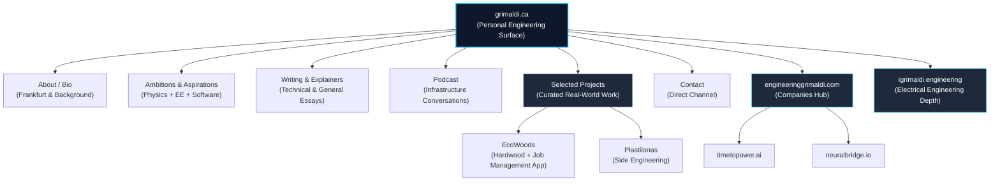

<div align="center">

# 🔱 grimaldi.ca

### **The Personal Engineering Surface & Human Layer**
*Architected for clarity, velocity, and deep technical execution.*

[](https://nextjs.org/)
[](https://www.typescriptlang.org/)
[](https://vercel.com)
[](https://grimaldi.ca)

[Explore Live Surface](https://grimaldi.ca) • [Companies Hub](https://engineeringgrimaldi.com) • [Electrical Depth](https://igrimaldi.engineering)

</div>

---

> *"Simplicity is prerequisite for reliability."* — The guiding principle behind this personal surface, built to give visitors, enterprise clients, and technical collaborators an immediate, noise-free view into the person behind the work.

---

## 🧭 Ecosystem Architecture

The Grimaldi engineering presence spans three dedicated surfaces, separating the corporate entities, deep electrical physics, and the human navigation layer.

| Layer | Surface | Core Focus & Role |
| :--- | :--- | :--- |
| **Corporate Hub** | [engineeringgrimaldi.com](https://engineeringgrimaldi.com) | Umbrella for **Time to Power / Gridforge** and **NeuralBridge** |
| **Electrical Depth** | [igrimaldi.engineering](https://igrimaldi.engineering) | High-voltage systems, machines, devices, and physics-informed methods |
| **Personal Surface** | **[grimaldi.ca](https://grimaldi.ca)** *(This Repo)* | Bio, broader ambitions, writing, podcast, selected projects, and direct contact |

*Product sites remain primary. This repository serves as your personal navigation and executive credibility layer.*

---

## 🧜‍♂️ Navigating the Surface

Like ancient mariners guided by constellations through treacherous waters, visitors to this surface navigate across distinct, purposeful dimensions of work and research.



---

## 🎯 Core Visitor Value Proposition

What clients, executives, and engineering leaders will instantly grasp upon landing:

* **Who**: **Vincenzo Ceccarelli Grimaldi** — Electrical Engineer based in Frankfurt am Main, specializing in power systems, physics-informed methods, digital twins, and software-defined infrastructure for physical systems.
* **What is Current**: Founder-led operations at *Time to Power / Gridforge* and *NeuralBridge*, deep electrical engineering research, alongside practical hands-on ventures like *EcoWoods* (Toronto hardwood contractor and custom job-management software) and *Plastilonas*.
* **Absolute Transparency**: No inflated revenue claims, no vanity metrics, and no abandoned product lines disguised as active operations. Every project represents genuine, production-grade work.
* **Where to Route**:
* *For Corporate Inquiries & Ventures* → [engineeringgrimaldi.com](https://engineeringgrimaldi.com)
* *For Power Grids, Traction Power & Physics-Informed Modeling* → [igrimaldi.engineering](https://igrimaldi.engineering)
* *For Personal Context, Writing & Direct Collaboration* → **[grimaldi.ca](https://grimaldi.ca)**


---

## 🏛️ Site Structure & Roadmap

| Section | Purpose | Operational Status |
| --- | --- | --- |
| **Home** | One-sentence positioning + intuitive routing paths | Active (Human-first, clean UI) |
| **About** | Professional narrative, Frankfurt roots, and engineering foundation | Active |
| **Ambitions** | Broader vision linking physics, electrical engineering, and physical software | Active |
| **Writing** | Deep-dive explainers and technical notes | Expanding |
| **Podcast** | Conversations on infrastructure, energy, and systems engineering | Curating |
| **Selected Projects** | Curated real-world work (including EcoWoods & Plastilonas) | Active |
| **Contact** | Direct, frictionless communication channel | Active |

---

## ⚡ Technical Stack & Architecture

Built for lightning-fast performance, type safety, and clean aesthetics:

* **Framework**: [Next.js](https://nextjs.org/) (App Router with static generation)
* **Language**: [TypeScript](https://www.typescriptlang.org/) for strict type safety
* **Styling**: Tailwind CSS with modular component architecture
* **Deployment**: Edge-optimized via [Vercel](https://vercel.com)

---

## 📬 Contact & Direct Channels

* **Primary Surface**: [grimaldi.ca](https://grimaldi.ca)
* **Corporate Hub**: [engineeringgrimaldi.com](https://engineeringgrimaldi.com)
* **Electrical Depth**: [igrimaldi.engineering](https://igrimaldi.engineering)
* **Direct Email**: [vincenzo@igrimaldi.engineering](https://www.google.com/search?q=mailto%3Avincenzo%40igrimaldi.engineering)
* **Location**: Frankfurt am Main, Germany

---

### **License**

Code: [MIT](https://www.google.com/search?q=LICENSE) • Content: All rights reserved unless otherwise noted.

*Designed and engineered with precision.*

```
